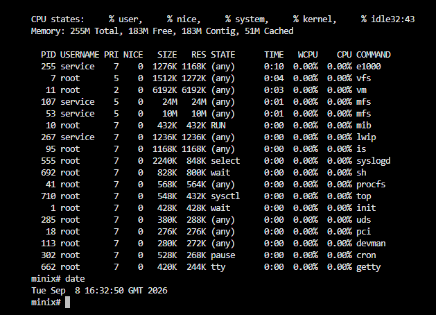

# minix3x
Experimental continuation and customization of MINIX.



## Contents

- [Documentation](#documentation)
- [Building the system](#building-the-system)
- [Creating a disk image](#creating-a-disk-image)
- [Creating a bootable CD image](#creating-a-bootable-cd-image)
- [Running the CD image in QEMU](#running-the-cd-image-in-qemu)
- [Running the CD image in Hyper-V](#running-the-cd-image-in-hyper-v)
- [Running the image in QEMU](#running-the-image-in-qemu)
- [Contributing / style guide](#contributing--style-guide)
- [VS Code auto-format on save](#vs-code-auto-format-on-save)

## Documentation

- [MINIX 3 Developers Guide](docs/developers-guide/README.md)

## Building the system

The steps below are for Debian/Ubuntu and build an i386 toolchain and release.
Start by installing the host build tools and development libraries:

```bash
sudo apt update
sudo apt install build-essential bison flex gawk git curl ca-certificates \
  patch tar bzip2 gzip perl python3 libncurses-dev zlib1g-dev
```

Clone this repository and enter its root directory if you have not already done
so. The build fetches two additional, version-pinned source archives; fetch them
before building:

```bash
sh gnu/dist/fetch.sh
sh external/gpl3/binutils/fetch.sh
```

These scripts need network access. The Binutils fetch script also applies the
MINIX patches tracked in this repository.

Build the whole system (toolchain + release) for i386:

```bash
HOST_CFLAGS='-O -fcommon' ./build.sh -j "$(nproc)" -m i386 \
  -O ../obj.i386 -D ../obj.i386/destdir.i386 -U -u release
```

`-fcommon` is needed when building the bundled legacy Texinfo with modern GCC.
The object and destination directories are placed alongside (not inside) the
source tree. A successful build creates release sets under
`../obj.i386/releasedir/i386/binary/sets/`.

## Creating a disk image

After a successful `make release`, generate a bootable disk image using the
`releasetools/x86_hdimage.sh` script (run it from the repository root):

```bash
ARCH=i386 OBJ=../obj.i386 releasetools/x86_hdimage.sh
```

The result is a `minix_x86.img` file in the repository root.

## Creating a bootable CD image

After a successful release build, generate a bootable ISO image using the
`releasetools/x86_cdimage.sh` script from the repository root:

```bash
ARCH=i386 OBJ=../obj.i386 releasetools/x86_cdimage.sh
```

The result is a `minix_x86.iso` file in the repository root. The script creates
a bootable i386 ISO with the MINIX kernel, boot modules, and CD boot menu.

## Running the CD image in QEMU

```bash
qemu-system-i386 -m 256 -cdrom minix_x86.iso
```

For a terminal-only display, use:

```bash
qemu-system-i386 -m 256 -cdrom minix_x86.iso -display curses
```

If KVM is available, add `--enable-kvm` to speed up emulation.

## Running the CD image in Hyper-V

The ISO uses legacy BIOS booting, so create a **Generation 1** virtual
machine. Generation 2 machines use UEFI and are not supported by this image.

1. Create a new Hyper-V virtual machine and select **Generation 1**.
2. Allocate at least 256 MB of memory.
3. In the virtual machine settings, open the IDE Controller's DVD Drive.
4. Select **Image file** and attach `minix_x86.iso`.
5. Set the DVD drive before the hard disk in the boot order, then start the VM.

The MINIX boot menu should appear after the VM starts.

## Running the image in QEMU

```bash
qemu-system-i386 -m 256 -drive file=minix_x86.img,format=raw,if=ide -display curses
```

Notes:
- `-display curses` renders the emulated screen as text in the current
  terminal and is useful in environments without X11/GTK (e.g. an SSH session
  or a VM without a GUI). If a graphical environment is available, you can
  drop this option or use `-display gtk`/`-display sdl` instead.
- If KVM is available (native Linux, or a VM with nested virtualization
  enabled), add `--enable-kvm` to speed up emulation.
- Only one QEMU instance can have the image file open at a time — a
  `Failed to get "write" lock` error means another QEMU process is already
  using it.

## Contributing / style guide

Install the Git hook once to update `package.json` and add the commit subject to
`RELEASE_NOTES.txt` automatically on each commit. The hook amends the local
commit to include these changes, so its hash changes. Python 3 is required:

```bash
sh ./scripts/install_hooks.sh
```

This repository keeps a lightweight C formatting setup for local development.
The project uses a repository-level [.clang-format](.clang-format) file and a
small helper script at [tools/format-file.sh](tools/format-file.sh).

Use the helper for a single file:

```bash
./tools/format-file.sh path/to/file.c
```

Or through the Makefile target:

```bash
make format FILE=path/to/file.c
```

The rule reads the project formatting settings from [.clang-format](.clang-format)
and runs `clang-format` in place on the selected file. Keep formatting local to
files you touch, rather than reformatting a large historical tree in one pass.

## VS Code auto-format on save

The workspace includes [.vscode/settings.json](.vscode/settings.json) with
`editor.formatOnSave` enabled for C/C++ files. This makes VS Code format the
current file automatically when it is saved, using the repository's
`.clang-format` style.

This is intended as a local convenience for contributors working in the repo,
without forcing a broad, repository-wide reformat of historical MINIX code.
